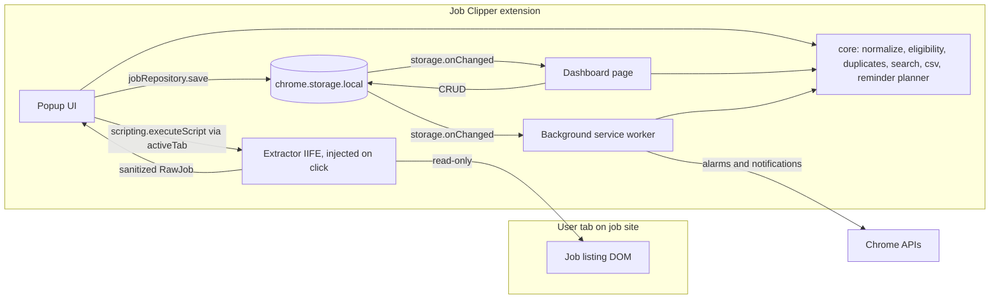
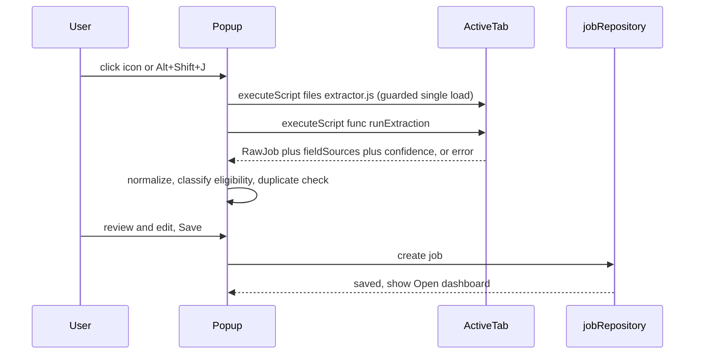
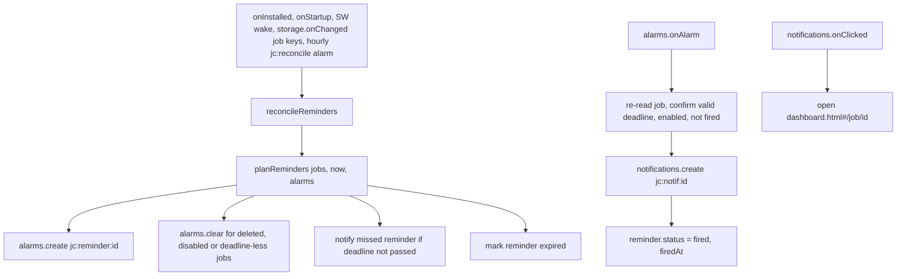
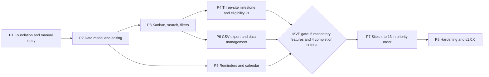

# Job Clipper — Phase 0 Specification

> BSERC GenAI Internship — Week 2, Project 10.
> Status: **Phases 1–8 are complete. Automated QA and manual QA are complete. The release zip was generated, and the project owner reported that a clean Chrome profile installation passed. v1.0.0 has not been committed or tagged.**
> The sections below are the Phase 0 specification of intended behaviour. The live record of what shipped, what was tested, and what is still manual entry is in [`README.md`](README.md). No integration is marked Verified: the formal criteria in section 12 need a recorded date, a Chrome version, and at least three live listings, and those details were not supplied.

## 0. Project state

- At the start of Phase 0 (2026-11-21) the workspace was **empty** (no files, not a git repository).
- Toolchain: Node 25.9, npm 11.12 (pnpm not installed, so the project uses **npm**).
- Phase 0 deliverables: this document, `prompts.md`, `README.md`, `CHANGELOG.md`. Phase 1 starts only after explicit approval.

**Revision 1 (2026-11-22) changes:**
- The 13-site integration priority is now explicit, with Internshala first.
- The first integration milestone is three genuinely tested sites.
- The remaining integrations are moved out of the critical path to the MVP.
- Deadlines are optional and never inferred.
- Reminders require a valid deadline.
- Manual clipping is guaranteed on every website.

Architecture, eligibility approach and visual direction are unchanged.

**Current progress (reported by the project owner):**
- Phases 1–7 are implemented. The project owner manually tested them in Chrome and confirmed that the implemented functionality works. The test date, Chrome version, macOS version and listing counts were not supplied.
- Phase 1: foundation, dashboard and manual entry.
- Phase 2: job management (create, read, update, delete).
- Phase 3: four-stage Kanban board.
- Phase 4: Internshala, LinkedIn and Naukri integrations.
- Phase 5: deadline management, reminders and calendar.
- Phase 6: search, filters, sorting, CSV export and data management.
- Phase 7: Wellfound, Y Combinator Jobs, Himalayas, We Work Remotely, Unstop and Cutshort integrations.
- Indeed, HiringCafe, Glassdoor and ZipRecruiter have no adapter. They stay manual-entry only because of access restrictions or unsupported pages. They are not part of the manually tested integrations.
- Phase 8 is complete as QA, documentation and packaging. The 2026-11-23 automated results are unchanged and are in the README verification log: Playwright dashboard tests, an axe pass, a 2,000-job benchmark, a security audit, and `npm run package` (`release/job-clipper-1.0.0.zip`, 619,135 bytes, 38 files). The project owner later reported that manual acceptance is complete: the clean-profile install passed, manual regression passed, the VoiceOver checklist was completed, backup and restore were tested, delete-all was tested, CSV compatibility was tested in the applications they used, and Chrome notification testing was completed. The test date, Chrome version, macOS version, VoiceOver announcements and spreadsheet names were not supplied. No site was marked Verified. Backup validation still does not use `zod`. The remaining repository actions are a git commit and a `v1.0.0` tag. Neither has been performed: there are no tags, and HEAD is the Phase 7 commit.

---

## 1. Product requirements (PRD)

**Vision:** Job Clipper is an offline-first Chrome extension that clips job and internship listings in one click, checks whether they are realistically open to an India-based applicant, and tracks them through to a result, with real deadline reminders. It has no backend, login, paid API, or cloud service.

**Primary user:** an Indian B.Tech student (SRM IST, graduating May 2027) targeting Data Engineering, Data Analyst, BI, Python, SQL, SWE internships, graduate trainee and new-grad roles.

**Mandatory BSERC features (non-negotiable), with the phase that delivers each:**

1. One-click save of role, company, link and deadline (Phase 1 manual entry, Phase 4 auto-detection). The deadline field is always present. It is saved when the listing states one or the user enters one; otherwise the job is still saved and shows "No deadline provided".
2. Every saved field editable (Phase 2).
3. Kanban board with the columns Saved, Applied, Interview and Result (Phase 3).
4. A reminder before the deadline, delivered by `chrome.alarms` + `chrome.notifications` (Phase 5).
5. Search and CSV export (search in Phase 3, CSV in Phase 6).

**BSERC completion criteria, with the phase that verifies each:**

- Works on three different job websites (Phase 4 milestone: the first three sites in priority order, Internshala, LinkedIn and Naukri, genuinely tested on live listings; see section 12 for the substitution rule if one is inaccessible).
- Manual entry when detection fails (Phase 1, and the fallback is preserved in every later phase).
- A deadline reminder actually appears (Phase 5 manual test with a short-lead reminder).
- The CSV opens correctly in a spreadsheet (Phase 6, checked in Google Sheets, Numbers and LibreOffice; also Excel if available).

**Out of scope:** backend, accounts, cross-device sync, auto-apply, background crawling, AI/LLM APIs, scraping search result lists, fetching company logos.

## 2. User stories and journeys

**User stories** (As a student, I want to…)

- clip the job I'm viewing with one click, so I don't retype title, company, link and deadline.
- type the details myself when the site isn't supported, so clipping never fails.
- be warned before saving the same job twice, but still be able to save it anyway.
- see whether a "Remote" job actually accepts applicants from India.
- edit any field later (deadline, notes, contact, eligibility override).
- drag cards between stages with a mouse, or move them with the keyboard.
- get a Chrome notification before a deadline, even after restarting Chrome.
- search and filter by role, source, eligibility and deadline.
- export all or filtered applications to a CSV that opens cleanly in a spreadsheet.
- see on one screen what's due, what's moving, and what I saved recently.

**Key journeys**

- **J1, supported site:** open a listing, click the toolbar icon (or press Alt+Shift+J), and the popup shows the detected fields with confidence chips. If the listing explicitly states a deadline (e.g. Internshala "Apply By"), it is prefilled along with the quoted label it came from. Otherwise the deadline field is empty and shows "No deadline provided". Review, then Save. A success state offers "Open dashboard".
- **J2, unsupported or failed detection:** the popup opens in manual mode with URL and page title prefilled from the tab. The user fills company (and a deadline if known), then Saves. This works on every website.
- **J3, duplicate:** the popup shows "Already saved on 12 Nov (Applied)". The user can open the existing entry or choose "Save anyway".
- **J4, pipeline:** on the Applications board, drag Saved to Applied (applied date set automatically, editable), then to Interview (optional interview date prompt), then to Result (outcome picker: Selected, Rejected, Withdrawn or No response).
- **J5, reminder:** when the deadline is near, a Chrome notification appears. Clicking it opens the dashboard with that job's drawer open.
- **J6, restart recovery:** Chrome was closed when a reminder was due. On next launch the reconciler shows a "Missed reminder" notification if the deadline hasn't passed; otherwise it marks the reminder expired.
- **J7, export:** filter to "Interview" and click Export, which downloads `job-clipper-filtered-2026-11-21.csv`.
- **J8, deadline added later:** the user saved a LinkedIn job with no deadline and later learns it closes on 30 Nov. They open the job drawer, enter the date, and the default reminder is scheduled automatically. Clearing the deadline again cancels the reminder.

## 3. Functional requirements (summary)

- **FR-Clip:** clip from the active tab via popup or shortcut. Runs a detection pipeline that falls back to manual entry. Shows a confidence indicator per field and checks for duplicates before saving. Manual clipping is available on every website, whether or not it has a verified adapter (section 12).
- **FR-Edit:** edit every field in the job drawer, with validation (required: title, company, http/https URL; deadline optional but always present as a field).
- **FR-Deadline:**
  - A job can be saved without a deadline. An unknown deadline is displayed as "No deadline provided" on cards, the drawer, the popup and the calendar agenda.
  - A deadline is prefilled only from an explicit, labelled deadline on the page. It is never inferred, estimated or derived from other dates.
  - The user can add, edit or clear the deadline at any time.
- **FR-Board:** four columns with drag-and-drop, keyboard moves, a "Move to" menu, delete with confirmation, open the original listing, inline notes, and status history.
- **FR-Eligibility:** rule-based India eligibility classification with reasons and a manual override that is never overwritten.
- **FR-Remind:** configurable default lead time, a per-job override, real notifications, rescheduling on edit, cleanup on delete, reconciliation on startup. Reminders are scheduled **only when a valid deadline exists**.
- **FR-Search:** full-text search plus multi-facet filters and five sort orders. Filter state persists in the URL hash.
- **FR-Export:** RFC 4180 CSV of all or filtered jobs, with a UTF-8 BOM and formula-injection protection. JSON backup and import with validation.
- **FR-Calendar:** month view of deadlines, interviews and reminders. Agenda list on narrow screens.

## 4. Non-functional requirements

- **Performance:** popup interactive in under 300 ms; extraction in under 500 ms (time-boxed at 2 s for single-page-app content); dashboard renders 1,000 jobs in under 1 s; search and filter in under 50 ms for 2,000 jobs.
- **Reliability:** no data loss across Chrome restarts and extension updates; versioned migrations; idempotent reminder scheduling.
- **Privacy:** all data stays local; no network calls by the extension; no analytics.
- **Security:** least privilege, no remote code, no `innerHTML`, validated inputs.
- **Accessibility:** WCAG 2.2 AA contrast, full keyboard operation, visible focus, `prefers-reduced-motion` respected, screen-reader announcements for drag-and-drop and saves.
- **Offline:** every installed feature works with no network.
- **Maintainability:** framework-free pure TypeScript `core/` (unit-tested); one isolated file per site adapter; strict TypeScript.
- **Compatibility:** Chrome 120 or newer (Edge and Brave likely work, but are untested and not claimed).

## 5. Technology architecture

**Stack:** Manifest V3, React 18/19, TypeScript (strict), Vite, Tailwind CSS v4 (`@tailwindcss/vite`, tokens via `@theme`), `@dnd-kit/core` + `@dnd-kit/sortable`, `zod` (validation), `date-fns`, `lucide-react` (tree-shaken SVG icons), `@fontsource` fonts (bundled locally). Tests use Vitest, jsdom, Testing Library, and Playwright (Phase 8 smoke tests).

**Build (plain Vite, no extension framework):**

- `vite.config.ts`: a multi-page build of `popup.html` and `dashboard.html`, plus `src/background/index.ts` emitted as `background.js` (ES module service worker).
- `vite.content.config.ts`: a library build of `src/content/extractor.ts` as a single **IIFE**. Scripts injected via `chrome.scripting.executeScript({ files })` cannot be ES modules.
- `npm run dev` runs both builds in `--watch` mode (via `concurrently`), and you reload the unpacked extension. `npm run build` produces `dist/`, and `npm run package` zips it.
- I chose this over CRXJS because there are fewer moving parts and the output is transparent.



**Responsibilities:**

- **Popup and dashboard** write through the shared `jobRepository`.
- **Service worker** is the _only_ owner of alarms and notifications. It observes `storage.onChanged` for `job:*` keys and reconciles that job's reminder. This means no UI code schedules alarms, so nothing gets scheduled twice.
- **Extractor** is read-only, runs in the ISOLATED world, returns plain data, and installs no persistent listeners.

**Clip sequence:**



On restricted pages (`chrome://`, the Web Store, PDFs) or on injection failure, the popup falls back to a manual form prefilled with `tab.url` and `tab.title`. The popup draft is saved to `chrome.storage.session` keyed by tab ID, so it survives the popup closing when it loses focus.

## 6. Folder structure

```
job-clipper/
  README.md  PROJECT_SPEC.md  prompts.md  CHANGELOG.md
  package.json  tsconfig.json  vite.config.ts  vite.content.config.ts
  vitest.config.ts  eslint.config.js  .prettierrc  .gitignore
  popup.html  dashboard.html
  public/
    manifest.json
    icons/ icon-16.png icon-32.png icon-48.png icon-128.png notification-128.png
  src/
    background/   index.ts  reminders.ts  reconcile.ts  notifications.ts  lifecycle.ts
    content/      extractor.ts  runExtraction.ts  waitForContent.ts
    adapters/     types.ts  registry.ts  merge.ts
      generic/    jsonld.ts  meta.ts  heuristics.ts  labelValue.ts
      sites/      linkedin.ts internshala.ts naukri.ts wellfound.ts indeed.ts ycombinator.ts
                  himalayas.ts weworkremotely.ts unstop.ts cutshort.ts
                  hiringcafe.ts glassdoor.ts ziprecruiter.ts   (added only when built)
    core/         (pure TS, no chrome or React imports)
      model/      types.ts  enums.ts  schema.ts  defaults.ts
      normalize/  url.ts  text.ts  location.ts  salary.ts  experience.ts  category.ts  dates.ts  normalizeJob.ts
      eligibility/ classify.ts  rules.ts  places.ts  phrases.ts
      duplicates.ts
      search/     searchIndex.ts  filters.ts  sort.ts
      csv/        columns.ts  toCsv.ts
      reminders/  computeRemindAt.ts  planReminders.ts
    storage/      chromeStorage.ts  jobRepository.ts  settingsRepository.ts  migrations.ts  backup.ts
    messaging/    protocol.ts (zod discriminated union)  client.ts
    ui/
      styles/     tokens.css  fonts.css  base.css
      components/ Button Input Textarea Select DateField Field Badge StatusPill EligibilityBadge
                  SourceMark CompanyAvatar Panel Card Dialog Drawer ConfirmDialog Toast
                  EmptyState Kbd GlowBackdrop StatNumber SegmentedControl Popover
      hooks/      useJobs useSettings useStorageSubscription useHashState useReducedMotion
    popup/        main.tsx PopupApp.tsx ClipForm.tsx DetectionSummary.tsx DuplicateNotice.tsx SavedState.tsx
    dashboard/
      main.tsx App.tsx router.ts
      layout/     AppShell.tsx TopNav.tsx
      overview/   OverviewPage Hero StatsRail ActivityPanel ProgressPanel DeadlinesPanel ExploreDialog
      applications/ ApplicationsPage Toolbar SearchBox FilterBar SortSelect KanbanBoard KanbanColumn
                  JobCard MoveMenu OutcomePicker MobileColumnSwitcher
      job/        JobDrawer JobForm (sections: Basics, Location and eligibility, Employment,
                  Tracking, Reminder, Contact, Notes)
      calendar/   CalendarPage MonthGrid AgendaList
      settings/   SettingsPage ReminderSettings ProfileSettings DataManagement About
  tests/
    fixtures/sites/<site>/<capture-date>-<n>.html   (trimmed, personal data removed)
    fakes/chrome.ts                                  (in-memory storage, alarms, notifications)
    e2e/                                             (Playwright, Phase 8)
```

Unit tests live next to their source files as `*.test.ts(x)`.

## 7. Data model and storage

```ts
type JobStatus = "saved" | "applied" | "interview" | "result";
type ResultOutcome = "selected" | "rejected" | "withdrawn" | "no_response";
type IndiaEligibility =
  | "india_onsite"
  | "india_hybrid"
  | "remote_india"
  | "remote_worldwide"
  | "remote_restricted"
  | "international_relocation"
  | "unknown";
type WorkArrangement = "onsite" | "hybrid" | "remote" | "unknown";
type EmploymentType =
  | "internship"
  | "full_time"
  | "contract"
  | "part_time"
  | "unknown";
type JobCategory =
  | "data_engineering"
  | "data_analyst"
  | "business_intelligence"
  | "python_developer"
  | "sql_developer"
  | "software_engineering"
  | "graduate_trainee"
  | "other";
type SourceId =
  | "linkedin"
  | "internshala"
  | "naukri"
  | "wellfound"
  | "indeed"
  | "ycombinator"
  | "himalayas"
  | "weworkremotely"
  | "unstop"
  | "cutshort"
  | "hiringcafe"
  | "glassdoor"
  | "ziprecruiter"
  | "other";

interface JobApplication {
  id: string; // crypto.randomUUID()
  schemaVersion: number;
  // Basic (title, company, url are required; deadline field always exists, may be null)
  title: string;
  company: string;
  url: string;
  canonicalUrl: string;
  source: SourceId;
  sourceJobId?: string;
  description?: string; // plain text, capped at 15,000 chars
  companyWebsite?: string;
  // Location and eligibility
  location: {
    raw?: string;
    city?: string;
    country?: string;
    countryCode?: string;
  };
  workArrangement: WorkArrangement;
  eligibleCountries: string[]; // ISO codes or region labels, e.g. ["IN"], ["US","CA"], ["Worldwide"]
  eligibility: {
    value: IndiaEligibility;
    confidence: "high" | "medium" | "low";
    reasons: string[];
    overridden: boolean;
    classifierVersion: number;
  };
  workAuthorization?: string;
  visaSponsorship: "yes" | "no" | "unknown";
  studentEligibility: "students" | "graduates" | "both" | "unknown";
  graduationYears: number[];
  // Employment
  employmentType: EmploymentType;
  experience: {
    raw?: string;
    minYears?: number;
    maxYears?: number;
    level: "internship" | "fresher" | "entry" | "mid" | "senior" | "unknown";
  };
  compensation: {
    raw?: string;
    currency?: string;
    min?: number;
    max?: number;
    period: "month" | "year" | "hour" | "lumpsum" | "unknown";
    kind: "salary" | "stipend" | "unknown";
  };
  skills: string[];
  category: JobCategory;
  // Tracking
  status: JobStatus;
  result?: ResultOutcome;
  statusHistory: { status: JobStatus; result?: ResultOutcome; at: string }[];
  savedAt: string;
  updatedAt: string;
  appliedAt?: string;
  interviewAt?: string;
  deadline: {
    // null = unknown, displayed as "No deadline provided"
    date: string; // YYYY-MM-DD, local time zone
    time?: string; // HH:mm; absent means 23:59 that day
    origin: "page_label" | "user";
    evidence?: string; // page_label only: quoted label text, e.g. "Apply By 28 Nov' 26"
  } | null;
  notes: string;
  contact?: {
    name?: string;
    email?: string;
    phone?: string;
    profileUrl?: string;
  };
  // Reminder
  reminder: {
    enabled: boolean; // preference; only takes effect when a valid deadline exists
    mode: "default" | "custom";
    leadDays?: number;
    atTime?: string;
    customAt?: string; // must be before the deadline
    remindAt?: string; // computed; undefined whenever deadline is null or invalid
    status: "none" | "scheduled" | "fired" | "missed" | "expired";
    firedAt?: string;
  };
  // Provenance
  extraction?: {
    adapter: string;
    adapterVersion: number;
    extractedAt: string;
    fieldSources: Record<
      string,
      "jsonld" | "adapter" | "meta" | "heuristic" | "user"
    >;
  };
}
```

**Field rules:**

- Raw strings are always preserved next to parsed values (`compensation.raw`, `experience.raw`, `location.raw`). The parsed values are best-effort, for display and filtering only.
- Deadlines are interpreted in the browser's local time zone. When no time is given, the deadline means 23:59 that day. (Limitation: there is no per-job time zone in v1.)
- **Deadline policy:**
  - `deadline` is `null` unless (a) the page shows an explicitly labelled application deadline, read by a verified adapter (`origin: "page_label"`, with the label text kept as `evidence`), or (b) the user enters it (`origin: "user"`).
  - The following are never used as a deadline: JSON-LD `validThrough` (a listing-expiry field, not an application deadline), posting dates, "apply soon" phrases, or dates guessed from description text.
  - A valid deadline is a real calendar date (time optional). Past dates may be saved (the job is shown as closed) but never get a reminder.
  - The UI shows "No deadline provided" wherever the deadline is `null`. A detected deadline is always visible and editable before saving.

**Storage layout (`chrome.storage.local`):**

- `schemaVersion`: number
- `settings`: reminder defaults (1 day before at 09:00), profile (graduation year 2027, country IN), CSV options, UI preferences
- `job:<uuid>`: one key per job. Writes are per job, which avoids popup and dashboard overwriting each other's whole-array writes. Conflicts resolve last-write-wins by `updatedAt`.
- `chrome.storage.session`: popup drafts only.
- UIs subscribe to `storage.onChanged`, so open dashboard tabs update live.

**Quota:** 10 MB, measured with `getBytesInUse`. Descriptions are capped. Settings shows usage and warns at 70%. Adding `unlimitedStorage` is reconsidered only if real usage requires it.

**Persistence:** `chrome.storage.local` survives browser restarts and extension updates; it is cleared only on uninstall. JSON backup protects against uninstall.

**Migrations:** `runtime.onInstalled` with `reason === 'update'` runs ordered migrations `vN → vN+1`. Migrations are idempotent and unit-tested.

**Duplicate detection:**

- **Exact match:** same `source` + `sourceJobId`, or the same `canonicalUrl` (lowercased host, `www.` stripped, tracking parameters such as `utm_*`, `trk`, `refId` and `trackingId` removed, and a site-specific canonical form, e.g. `linkedin.com/jobs/view/<id>`, `in.indeed.com/viewjob?jk=<id>`).
- **Probable match:** normalized company + title, where normalization lowercases, strips punctuation and suffixes like "Pvt Ltd"/"Inc", and collapses whitespace. It counts as a match if the token similarity is at least 0.9 and the existing job was saved within 60 days.
- The UI shows the existing job and offers Open existing, Update existing, or Save anyway.

## 8. Manifest V3 permission plan

```json
{
  "manifest_version": 3,
  "name": "Job Clipper",
  "version": "0.1.0",
  "minimum_chrome_version": "120",
  "action": { "default_popup": "popup.html", "default_title": "Clip this job" },
  "background": { "service_worker": "background.js", "type": "module" },
  "permissions": [
    "storage",
    "alarms",
    "notifications",
    "activeTab",
    "scripting"
  ],
  "commands": {
    "_execute_action": { "suggested_key": { "default": "Alt+Shift+J" } }
  },
  "content_security_policy": {
    "extension_pages": "script-src 'self'; object-src 'self'"
  },
  "icons": {
    "16": "icons/icon-16.png",
    "48": "icons/icon-48.png",
    "128": "icons/icon-128.png"
  }
}
```

**Permissions requested, and why:**

- `storage`: persist jobs and settings locally (`storage.session` is used for popup drafts).
- `alarms`: schedule deadline reminders that survive the service worker being suspended.
- `notifications`: show reminder notifications.
- `activeTab`: temporary access to _only_ the tab the user is on, granted when they click the icon or press the shortcut. This replaces broad host access.
- `scripting`: inject the extractor into that tab via `executeScript`.

**Deliberately not requested:**

- `host_permissions` / `<all_urls>`: not needed because `activeTab` covers it, and there are no static content scripts.
- `tabs`: `activeTab` already exposes the active tab's URL and title after the user clicks, and `tabs.create` needs no permission.
- `downloads`: CSV export uses a Blob plus `<a download>` from the dashboard page.
- `unlimitedStorage`: deferred, as above.
- `contextMenus`: an optional right-click "Clip job" entry, considered in Phase 7 only if wanted.
- No `externally_connectable`, `web_accessible_resources` or `cookies`.

**Possible future enhancement (not in v1):** `optional_host_permissions` for supported sites, requested at runtime, to show a toolbar badge when a job is detected. This would only be added with explicit opt-in.

## 9. Component hierarchy

**Popup** (380 px wide, max 600 px tall):

```
PopupApp
  Header (brand mark, "Open dashboard" icon button)
  DetectionSummary (source mark, "Detected 4/6 fields" or "Manual entry")
  DuplicateNotice (conditional)
  ClipForm
    Field: Title*, Company*, URL*, Deadline (date + optional time; empty shows "No deadline provided";
           if read from a page label, shows the quoted label as evidence)
    EligibilityBadge + reasons, editable select
    Collapsible "More details": location, arrangement, type, category, salary/stipend, status
  StickyFooter: [Save to Job Clipper] [Open dashboard]
  SavedState (success: Open in dashboard, Clip another)
```

**Dashboard:**

```
App
  AppShell
    TopNav (brand | Overview, Applications, Calendar, Settings | Add application, Export)
    Route
      OverviewPage
        Hero (GlowBackdrop, headline, CTAs) + StatsRail (left 2 stats, right 2 stats)
        ActivityPanel (left) | ProgressPanel (centre) | DeadlinesPanel (right)
        ExploreDialog (curated search links per site and role)
      ApplicationsPage
        Toolbar (SearchBox, FilterBar, SortSelect, result count, Export filtered)
        KanbanBoard
          KanbanColumn x4
            JobCard (title, company, location, type, deadline, eligibility, source, status or outcome)
              MoveMenu, quick actions (open listing, edit, notes, delete)
        MobileColumnSwitcher (narrow screens)
      CalendarPage (MonthGrid | AgendaList)
      SettingsPage (ReminderSettings, ProfileSettings, DataManagement, About)
  JobDrawer (JobForm sections), ConfirmDialog, Toast region (aria-live)
```

**Routing:** a tiny hash router (`#/overview`, `#/applications?status=...&q=...`, `#/job/<id>`). No routing library is needed.

## 10. Design system (inspired by Northline, adapted)

**Character:** cinematic, editorial, dark. One strong light source in lime, and restraint everywhere else. Nothing from Northline is copied: no "N" logo, no copy, no exact layout. Job Clipper gets its own mark (a stylised clip/bookmark glyph in a rounded square).

**Colour tokens** (Tailwind v4 `@theme` in `src/ui/styles/tokens.css`, shared by popup and dashboard):

- `--color-bg` #080908; `--color-surface-1` #0E100E; `--color-surface-2` #141714; `--color-elevated` rgba(24,27,23,0.72) with backdrop blur on small panels only
- `--color-border` rgba(242,240,230,0.08); `--color-border-strong` #2A2E26
- `--color-text` #F2F0E6 (warm off-white); `--color-text-muted` #9B9D93; `--color-text-subtle` #74776C (non-essential text only, at least 4.5:1 on bg)
- `--color-accent` #C6F135 (lime); `--color-accent-hover` #D6F86B; `--color-accent-ink` #0A0C06 (text on lime)
- `--color-olive` #5E6B25; `--color-olive-surface` #1E2410 (badge fills, chart area)
- Semantic, desaturated: `--color-warn` #E9C46A (deadline within 3 days), `--color-danger` #E07A6F (overdue, rejected), `--color-info` #A8B5A0
- Glow: `--glow-lime` radial-gradient(ellipse at 50% 70%, rgba(198,241,53,0.22), transparent 60%)

**Typography** (all bundled via `@fontsource`, OFL-licensed, with system fallbacks):

- Display serif: **Instrument Serif** (regular + italic), falling back to Georgia/serif. Used for hero and page headlines and large statistics.
- UI sans: **Inter Variable**, falling back to system-ui. Used for data, forms, buttons and body text.
- Mono: **JetBrains Mono Variable**, falling back to ui-monospace. Used for uppercase micro-labels, nav items, timestamps and source tags.
- Scale: display clamp(48px, 7vw, 88px)/0.95; h1 48; h2 32 (serif); h3 18 (sans semibold); body 14–15; small 13; micro 11 mono uppercase with 0.14em tracking.

**Hero treatment:** "Your next _opportunity_ / _starts here._" The word _opportunity_ is set in italic lime and "starts here." in italic off-white, echoing the reference's mixed roman/italic rhythm. Supporting text is in muted sans. The primary CTA "Add an application" is a lime pill; the secondary CTA "Explore opportunities" is a ghost pill with a hairline border.

**Stats rail:** four large serif numbers flank the hero (two left, two right), each with a mono micro-label: Tracked, Applied this week, Interviews, Due in 7 days. These are computed from real data, never fake numbers.

**Glow and light rays:** CSS only, no images:

- a radial lime gradient behind the hero's bottom centre;
- a masked `repeating-linear-gradient` of faint vertical streaks (the "light curtain");
- a 1 px top-highlight border on panels.

Glow is used only on the hero and the focused centre panel. No green surfaces beyond buttons and badges.

**Three-panel composition** (below the hero, as in the reference):

- **Left, "Recently saved":** rows with a company initials avatar, title, and status pill (lime fill = Interview, lime outline = Applied, muted = Saved).
- **Centre, "Application overview":** a big serif total, "/ N active", a "Reminders on" pill, a hand-rolled SVG area chart of saves per week, and a pipeline progress bar across the four stages.
- **Right, "Upcoming deadlines":** a 14-day horizontal timeline with a lime "today" line and deadline markers, plus a list of the next five deadlines. A muted footer line ("4 saved jobs have no deadline provided") links to the "No deadline" filter. Jobs without a deadline never appear on the timeline.
- At 1280 px and wider, the side panels get a subtle perspective tilt. The tilt is disabled for reduced motion and below 1280 px.

**Components:**

- Pills: 999 px radius; status pills use outline vs fill instead of many colours.
- Cards: `surface-2`, 1 px border, 14 px radius, hover raises the border to `border-strong`.
- Panel headers: a lime dot plus a mono label (e.g. "• Upcoming deadlines").
- Focus ring: 2 px lime outline with 2 px offset (`:focus-visible`).

**Kanban styling:** dark cards with a 2 px left accent strip only for urgency (warn/danger) and a lime accent for Interview and Selected. Mono source tag (e.g. `INTERNSHALA`). Deadline shown as "Due 24 Nov · 3d", or "No deadline provided" in muted text with no urgency strip. While dragging, the card lifts with a slight scale (1.02) and lime border, and the drop column gets a faint lime inner glow. Animations are 150–200 ms, and none run under reduced motion.

**Motion:** opacity and transform only. `prefers-reduced-motion: reduce` removes transitions, tilt and the drag scale.

## 11. Responsive strategy

- **Breakpoints:** sm 640, md 768, lg 1024, xl 1280.
- **Overview:**
  - xl: hero with stats rail on both sides, three panels in a row.
  - lg: stats move under the hero in a 4-across row, panels stay three-across without tilt.
  - below lg: stats in a 2x2 grid, panels stacked (centre first).
- **Kanban:**
  - xl: four columns visible.
  - md–lg: horizontal scroll with scroll-snap, columns at least 280 px.
  - below md: a segmented control switches between columns, one is visible at a time, and the "Move to" menu is the primary move mechanism (touch drag still enabled via the touch sensor).
- **Job drawer:** 480 px right sheet on lg and up; full-screen sheet below.
- **TopNav:** collapses to brand + menu button below md.
- **Popup:** fixed 380 px width; scrollable body; sticky footer actions; "More details" collapsed by default.

## 12. Job site integration strategy

**Extraction pipeline** (runs in the user's tab, read-only, on click):

1. `registry.match(url)` selects a site adapter, or `generic`.
2. Wait up to 1.5 s for key content (MutationObserver) on single-page-app sites.
3. Collect from four sources in parallel:
   - **JSON-LD** `JobPosting` (title, hiringOrganization, jobLocation, jobLocationType, applicantLocationRequirements, employmentType, baseSalary, description). `validThrough` is ignored, because it is listing expiry, not an application deadline;
   - **meta / OpenGraph** tags;
   - the **site adapter** (semantic DOM: `h1`, ARIA roles and labels, `data-*` attributes, URL structure, label-to-value proximity such as "Apply By", "Stipend" or "Experience");
   - **generic heuristics** (document title, first `h1`, canonical link). Heuristics never produce a deadline.
4. Merge by field priority. The default is adapter, then JSON-LD, then meta, then heuristics; an adapter can declare `preferJsonLd`. Each field is tagged with its source. **Deadline exception:** only a site adapter reading an explicitly labelled deadline element (e.g. Internshala "Apply By", Unstop "Registration Deadline") may set `deadline`. Every other source leaves it `null` (see the deadline policy in section 7).
5. Sanitize (strip control characters, collapse whitespace, cap lengths, http/https URLs only) and validate with zod.
6. Return to the popup. Any failure gives a partial result plus manual entry, never an error dead-end.

**Adapter contract:**

```ts
interface SiteAdapter {
  id: SourceId;
  name: string;
  version: number;
  matches(url: URL): boolean;
  canonicalize(url: URL): { canonicalUrl: string; sourceJobId?: string };
  isJobPage(doc: Document, url: URL): boolean;
  extract(ctx: { doc: Document; url: URL }): AdapterResult; // partial fields + fieldSources
  preferJsonLd?: boolean;
}
```

**Rules:**

- The extension makes no network requests to job sites.
- It never reads cookies, storage or form inputs.
- It never dismisses login modals or bypasses walls; it reads only what the user can already see.
- Class-name selectors are only a last fallback, and always with alternatives.

**Support labels in README** (honest status):

- `Planned`, `In development`, or `Verified`.
- `Verified` means title, company and URL are detected correctly on at least 3 distinct live listings, fixture tests pass, and the date and Chrome version are recorded.
- Sites whose access is blocked are documented as "Manual entry only".
- The registry has an `enabled` flag per adapter. Release builds enable only `Verified` adapters. Every other site, including in-development adapters, uses the generic extractor plus manual entry, so an unfinished adapter can never ship half-working.

**Manual clipping guarantee:** manual entry is available on every website, whatever the adapter status.
- On any http(s) page, the popup always shows an editable form. It is prefilled with whatever was safely detected (at minimum the tab URL and page title) and falls back to empty fields.
- Where injection is impossible (`chrome://` pages, the Chrome Web Store, the PDF viewer, `file://`), the popup still opens the manual form, with the URL prefilled when Chrome exposes it.
- The dashboard's "Add application" opens the same form with no page at all.
- No adapter failure, timeout or unsupported site can block saving.

**Integration priority (fixed order, tiers preserved):**
1. Internshala (Tier 1)
2. LinkedIn Jobs (Tier 1)
3. Naukri (Tier 1)
4. Wellfound (Tier 1)
5. Indeed (Tier 1)
6. Y Combinator Jobs (Tier 1)
7. Himalayas (Tier 2)
8. We Work Remotely (Tier 2)
9. Unstop (Tier 2)
10. Cutshort (Tier 2)
11. HiringCafe (Tier 3)
12. Glassdoor (Tier 3)
13. ZipRecruiter (Tier 3)

**First integration milestone (Phase 4): three genuinely tested sites.**
- The targets are priorities 1–3: Internshala, LinkedIn and Naukri. Each must reach `Verified` on live listings the user can legitimately access.
- **Substitution rule:** if one of them proves inaccessible or unreliable (e.g. Naukri bot protection blocks rendering), it is recorded as such in the README. The next site in priority order (Wellfound, then Indeed, then Y Combinator Jobs) takes its place until three sites are `Verified`.
- Sites 4–13 are delivered in Phase 7, in the order above. They are **not** on the critical path: reminders (Phase 5) and CSV export (Phase 6) depend only on Phases 2–3, and the MVP gate at the end of Phase 6 requires only this three-site milestone.

**Per-site notes,** listed in priority order. URL patterns and fields are _expectations to verify_, not guarantees.

**Tier 1, priorities 1–3 (Phase 4 milestone):**

- **1. Internshala:**
  - URLs: `/internship/detail/<slug>`, `/job/detail/<slug>`.
  - Fields: profile, company, location or "Work from home", stipend (₹), duration, start date, and an **"Apply By" deadline** (an explicit label, read with label-value matching). This is the best deadline source.
  - Risk: low to medium.
- **2. LinkedIn Jobs:**
  - URLs: `/jobs/view/<id>`, `/jobs/search/?currentJobId=<id>`, `/jobs/collections/...?currentJobId=<id>`.
  - Logged-out guest pages often carry JSON-LD; the logged-in split view does not, so semantic DOM is read from the details pane.
  - Deadline: not published, so it shows "No deadline provided".
  - Risk: high DOM churn, and a restrictive ToS (user-initiated reading of the visible page only, no automation).
- **3. Naukri:**
  - URLs: `/job-listings-<slug>-<id>`.
  - Single-page app; JSON-LD expected; experience range ("0-2 Yrs"), salary ("4-6 Lacs PA"), locations.
  - Deadline: rarely published as a labelled field; read only if an explicit label exists, otherwise "No deadline provided".
  - Risk: bot protection may block pages entirely; we only read rendered content. Wellfound is the first substitute.

**Tier 1, priorities 4–6 (Phase 7, first in queue; substitutes for the milestone if needed):**

- **4. Wellfound:**
  - URLs: `/jobs/<id>-<slug>`, `/company/<co>/jobs/<id>-<slug>`.
  - Many listings require login; remote policy text ("Remote only in US") is very useful for eligibility.
  - Deadline: not published.
  - Risk: medium to high (login, Cloudflare).
- **5. Indeed:**
  - URLs: `in.indeed.com/viewjob?jk=<id>`, `/jobs?...&vjk=<id>`. The canonical form keeps the country subdomain.
  - JSON-LD or semantic DOM. Deadline: not a labelled field. Dates mentioned in description text are **not** extracted; the user can type them in.
  - Risk: verification challenges, which the user solves; we never automate them.
- **6. Y Combinator Jobs:**
  - URLs: `ycombinator.com/companies/<co>/jobs/<id>-<slug>`.
  - JSON-LD expected; location like "Remote (US)" plus visa text, which feeds eligibility and sponsorship.
  - `workatastartup.com` requires login and is a separate, later pattern.
  - Risk: low.

**Tier 2, priorities 7–10 (Phase 7):**

- **7. Himalayas:** `himalayas.app/companies/<co>/jobs/<slug>`; JSON-LD; explicit location-restriction country lists, which make it the strongest eligibility source. Risk: low.
- **8. We Work Remotely:** `/remote-jobs/<slug>`; "Region: Anywhere in the World / USA Only" label. Risk: low.
- **9. Unstop:** `/internships/<slug>-<id>`, `/jobs/<slug>-<id>` (competitions ignored); single-page app; an explicit **registration deadline** label is usually shown. Risk: medium.
- **10. Cutshort:** `/job/<slug>-<id>`; experience, salary, skills; some pages need login. Risk: medium.

**Tier 3, priorities 11–13 (Phase 7, time-boxed, optional):**

- **11. HiringCafe:** aggregator; job details are in a modal or viewer and often link out to the employer's applicant tracking system. Recommendation: clip the destination page instead (the generic JSON-LD adapter often works on Greenhouse, Lever, Ashby and Workday pages).
- **12. Glassdoor:** strong login overlay and anti-bot measures. Read visible content only; likely ends up "Manual entry only".
- **13. ZipRecruiter:** US-centric and may be geo-restricted from India; low value for this user. Likely "Manual entry only".

**Generic adapter bonus:** JSON-LD and meta extraction works on many company career pages. It's documented as "best effort", not claimed as support.

**Deadline honesty:**
- Only Internshala and Unstop are expected to show an explicitly labelled application deadline.
- Everywhere else the deadline stays `null` ("No deadline provided") until the user enters one.
- Nothing is inferred: no `validThrough`, no description-text dates, no estimates.
- A detected deadline is shown with its quoted label (e.g. `From page: "Apply By 28 Nov' 26"`) so the user can confirm or edit it before saving.

**Completion criterion target:** the three-site milestone above (Internshala, LinkedIn, Naukri, or substitutes in priority order). The other ten sites follow in Phase 7 and never gate the mandatory features.

**Explore opportunities:** a dialog of curated, editable search URLs per site and role (e.g. Internshala data-science internships; LinkedIn "Data Engineer Intern", India, past week). These are links only, opened in new tabs, with no scraping.

## 13. India eligibility classification

The classifier is a pure function: `classify(input, siteContext) -> { value, confidence, reasons[], evidence[] }`.

Work arrangement and applicant eligibility are separate fields. "On-site", "Hybrid", "Remote", and "Work from home" describe where the work happens. They do not say which applicants may apply. "Work from home" is recorded as a remote arrangement. That label never, by itself, establishes that applicants in India are eligible. The platform does not change this, including India-focused sites such as Internshala, Naukri, Unstop, and Cutshort.

Rules are evaluated in this order:

1. **User override** (`overridden: true`) is always kept; re-classification never touches it.
2. **On-site or hybrid** with a location in India (country code IN, or an Indian city from a dictionary of about 60 cities with aliases such as Bengaluru/Bangalore, Gurugram/Gurgaon, NCR) gives **India — On-site** or **India — Hybrid** (high confidence).
3. **Remote** with explicit India applicant eligibility gives **Remote — India eligible**. The only evidence that counts is a JSON-LD `applicantLocationRequirements` entry that includes India, a phrase such as "Remote (India)" or "Anywhere in India", or India in the eligible-country list. "Work from home", a bare "Remote" label, and the fact that the site lists roles for applicants in India are not this evidence.
4. **Remote** with worldwide phrases ("anywhere in the world", "worldwide", "work from anywhere", WWR "Anywhere in the World", Himalayas "Worldwide") **and** no restriction phrases gives **Remote — Worldwide**. "Work from anywhere" is a worldwide applicant statement. It is not the same label as "Work from home".
5. **Remote** with restriction signals ("US only", "must reside in", "EU/EEA/UK only", "Americas", "authorized to work in the United States", a country list without India) gives **Remote — Restricted region**. Time-zone overlap requirements are recorded as a note, not as a restriction.
6. **On-site or hybrid outside India** gives **International — Relocation required**, with `visaSponsorship` set from phrases ("visa sponsorship available", "will sponsor", "no sponsorship", "US citizens only").
7. **Remote or work-from-home with no explicit India applicant evidence, conflicting signals, or no location** gives **Unknown — Verify manually**. A job is never classified India-eligible just because it says "Remote" or "Work from home".

**Batch matching:** the same module extracts graduation years ("2026/2027 batch", "graduating in 2027") and student status ("currently pursuing", "final-year"). It compares them with the profile setting (2027) to show "Matches 2027 batch", "Excludes 2027", or nothing.

**UI:** the badge shows a tooltip with reasons and evidence snippets (120 characters or fewer). Unknown is styled neutral with a "Verify" action, and the badge is editable everywhere.

**Tests:** table-driven, with 40+ cases including tricky ones such as "Remote, APAC" (gives Unknown unless India is listed), "Remote US or India", "Bangalore, Karnataka" without a country, and "Work from home" on an India-focused site (Unknown unless one of the explicit India applicant statements above is also present).

## 14. Kanban and drag-and-drop

- Built with `@dnd-kit/core` + `@dnd-kit/sortable`, using PointerSensor, TouchSensor and KeyboardSensor (Space to lift, arrow keys to move between columns, Space to drop, Esc to cancel). Custom screen-reader announcements read, for example, "Moved Data Analyst Intern at Zomato to Applied".
- Every card also has a "Move to…" menu and shortcuts on the focused card (`[` and `]` to move to the previous or next stage), so drag-and-drop is never the only path.
- **Drag changes status only.** Within a column, cards follow the active sort (default: deadline approaching). This avoids a manual ordering that would conflict with sorting.
- **Side effects of moving:**
  - to Applied: sets `appliedAt` = today if empty;
  - to Interview: an optional, non-blocking interview-date popover;
  - to Result: the OutcomePicker (Selected, Rejected, Withdrawn, No response); if left unset, the card shows "Outcome not set".
  - Every move appends to `statusHistory` and persists immediately (optimistic UI, with rollback and a toast on write failure).
- **Card actions:** open listing (validated URL via `tabs.create`), edit (drawer), notes (drawer opens at the Notes field), delete (native `<dialog>` confirmation naming the job).
- The Result column shows outcome badges and supports filtering by outcome. No extra columns are added.

## 15. Deadline reminders and alarm recovery

**Computing the reminder time:**

- **Precondition: a reminder exists only when there is a valid deadline.**
  - `computeRemindAt(deadline, reminder, settings)` returns `null` when `deadline` is `null`, not a valid date, or already passed. A `null` result means no alarm, and `reminder.status = 'none'` (or `'expired'` for a passed deadline).
  - The reminder toggle remains a stored preference. In the UI it is disabled with the hint "Add a deadline to enable reminders" until a deadline exists.
- The default is **1 day before the deadline at 09:00**. Presets: same day 09:00, or 1, 2, 3 or 7 days before at the configured time. Custom: any datetime that is **before** the deadline (validated).
- If the computed time has already passed but the deadline is still in the future, the reminder is scheduled in about 1 minute with "deadline is soon" wording.
- **Deadline added later:** if the reminder preference is on, setting a deadline on a previously deadline-less job schedules the reminder automatically.
- **Deadline cleared:** the alarm is cleared and the status returns to `'none'`.

**Alarm design:**

- The alarm name is `jc:reminder:<jobId>`. `alarms.create` with the same name replaces the existing alarm, so scheduling is idempotent and duplicates are impossible.
- `planReminders(jobs, now, existingAlarms)` is a pure function returning `{ create, clear, fireMissed, markExpired }`, unit-tested with fake time.



**Service worker rules:**

- All listeners are registered synchronously at the top level of `background/index.ts`. This is required in MV3 so that events wake the worker, and it prevents duplicate listeners because there is no registration inside callbacks.
- Reconciliation runs through a single promise-chain mutex, so concurrent triggers can't double-fire.
- A notification is shown only if `status !== 'fired'`, and the status is written right after.

**Lifecycle handling:**

- **Edit:** a deadline or reminder change triggers `storage.onChanged`, which reschedules that job's alarm. Adding a deadline schedules it; removing the deadline clears it.
- **No deadline:** the job is never given an alarm, and the planner clears any stale alarm for it.
- **Delete:** a removed key clears both the alarm and the notification.
- **Expired deadline:** the card shows "Closed 3d ago" in danger colour, the reminder becomes `expired`, and the "Overdue" filter applies. Jobs are never moved automatically.

**Known Chrome limitations, and mitigations:**

- Alarms _may_ be cleared on browser restart and are typically cleared on extension update. Mitigation: reconcile on `onStartup` and `onInstalled`, plus every hour.
- The minimum delay is 30 s (Chrome 120+). That is irrelevant for deadlines. For testing, there are two separate tools:
  - "Remind me in 1 minute" in the job drawer sets a custom reminder time on a job that **has a valid future deadline**, so it exercises the real reminder path.
  - "Send test notification" in Settings is a diagnostic that checks OS notification permission. It is not a job reminder.
- Alarms don't fire while Chrome is closed. When Chrome next starts, the reconciler sends a "missed" notification.
- Alarms that come due while the device is asleep fire on wake.
- There is a cap of roughly 500 active alarms per extension. Mitigation: only the nearest 400 future reminders are scheduled, and the hourly reconcile tops up the rest.
- `setTimeout` is never used for reminders.

**macOS caveat:** Chrome notifications require System Settings, then Notifications, then Google Chrome to be allowed, and Focus modes can hide them. Settings includes a "Send test notification" button and a troubleshooting note.

## 16. Search, filters and sorting

- **Search index:** an in-memory haystack per job (title, company, location raw, city, country, skills, description, notes), lowercased and with diacritics stripped, memoized by `id + updatedAt`. Queries are split into tokens and every token must match (AND). Input goes through `useDeferredValue`. Shortcuts: `/` or Cmd/Ctrl+K focuses search. This is fast enough for thousands of jobs without a search library.
- **Filters** (multi-select popovers, combined with AND across facets and OR within a facet):
  - status (+ result outcome), source, employment type, category, India eligibility, work arrangement, experience level;
  - deadline range: Overdue, Next 7 days, Next 30 days, No deadline provided, or a custom range (date ranges never include deadline-less jobs).
- **Sorting:** Recently saved, Deadline approaching (jobs without a deadline go last), Recently updated, Company A–Z, Job title A–Z.
- **State:** stored in the URL hash query, so it survives reloads and is shareable between tabs. "Clear all" resets it. The result count is shown. Export uses the current filtered set.

## 17. CSV export specification

- **Columns, in order:**
  - ID, Job Title, Company, Job URL, Source, Location, City, Country, Work Arrangement;
  - Employment Type, Category, India Eligibility, Eligibility Overridden, Visa Sponsorship;
  - Experience Requirement, Salary/Stipend (raw), Skills (joined with "; ");
  - Deadline (`YYYY-MM-DD HH:mm`; the cell is left **empty** when no deadline is provided, so spreadsheet date sorting and filtering still work), Deadline Source ("Page label", "Entered by user", or empty), Status, Result, Date Saved, Date Applied, Interview Date;
  - Reminder (e.g. "On – 2026-11-23 09:00"), Contact Name, Contact Email, Notes;
  - optional: Description (off by default).
- **Encoding:** RFC 4180 with CRLF row endings. A field is quoted when it contains a comma, quote, CR or LF. Embedded quotes are doubled. The file starts with a UTF-8 BOM (`\uFEFF`) so Excel shows ₹, Hindi and Tamil text correctly. Enum values are written as human-readable labels.
- **Formula-injection guard:** cells starting with `= + - @ \t \r` are prefixed with `'`.
- **Filenames:** `job-clipper-all-YYYY-MM-DD.csv` or `job-clipper-filtered-YYYY-MM-DD.csv`.
- **Generation:** client-side as a Blob, downloaded via a temporary `<a download>`, then `URL.revokeObjectURL`. Nothing touches a server.
- **Unit tests:** commas; double quotes; multiline notes; CRLF inside a field; "₹ 15,000 /month"; "4-6 Lacs P.A."; emoji; Devanagari and Tamil text; leading `=SUM(...)`; empty and undefined fields; 10k-character notes; column order snapshot.
- **Manual check:** open in Google Sheets, Apple Numbers and LibreOffice (and Excel if available), and confirm the columns are aligned and the characters are intact.
- **JSON backup/import (Phase 6):** a versioned envelope `{ app, schemaVersion, exportedAt, jobs, settings }`. Import is size-limited (5 MB) and validated with zod. It previews counts, then merges by ID or canonical URL (skip or overwrite chosen by the user), runs migrations for older versions, and rejects unknown future versions.

## 18. Security and privacy

- **No remote code:** the MV3 CSP is `script-src 'self'`; no `eval`; all assets are bundled.
- **Untrusted page data:**
  - the extractor returns only primitive strings and arrays;
  - descriptions are converted to text via `textContent` / `innerText`;
  - there is no `dangerouslySetInnerHTML` (enforced by an ESLint rule) and no `innerHTML` anywhere;
  - long text is rendered with `white-space: pre-wrap`;
  - field lengths are capped and control characters stripped.
- **URLs:** only `http:`/`https:` are accepted for job, company and contact URLs. Others are rejected at validation and again when opened (`tabs.create` after re-validation).
- **Messaging:**
  - `runtime.onMessage` handlers check `sender.id === chrome.runtime.id` and validate payloads against the zod `protocol.ts` union;
  - no `externally_connectable`;
  - the extractor doesn't listen to page `postMessage`;
  - injection is guarded with `globalThis.__jcExtractorLoaded` so repeat clicks don't stack code.
- **Least privilege:** see section 8. There is no access to any site until the user clicks.
- **Data minimization:** the extension never collects cookies, passwords, sessions, page form values, or the user's profile data on job sites. Contact details are only stored if the user types them.
- **Privacy statement in README:** data never leaves the device; no analytics; uninstalling deletes the data (back up with JSON first).
- **Logging:** production builds strip debug logs.

## 19. Offline functionality

- Fonts (`@fontsource` files), icons (`lucide-react` SVG), the notification icon PNG and all JavaScript and CSS are packaged in `dist/`.
- There are no CDN links and no runtime fetches.
- Company avatars are generated initials, not remote logos.
- The dashboard, popup, editing, search, export, calendar and reminders all work offline.
- Extraction only needs the job page the user has already loaded.
- Phase 1 includes a verification step with the network disabled in DevTools.

## 20. Testing strategy

- **Unit tests (Vitest), for pure `core/`:** URL canonicalization per site, normalization (salary, experience, location, category), duplicates, the eligibility rules table, search, filters and sort, CSV, `computeRemindAt` and `planReminders` (fake timers), zod schemas, migrations. Target coverage for `core/` is at least 85% lines.
- **Deadline policy tests** (a dedicated suite):
  - a job saves with `deadline: null`;
  - JSON-LD `validThrough` and dates in description text never populate `deadline`;
  - `computeRemindAt` returns `null` for null, invalid or past deadlines;
  - the planner never creates an alarm for a deadline-less job and clears stale ones;
  - adding a deadline later schedules a reminder, and clearing it cancels the reminder;
  - a custom reminder time after the deadline is rejected;
  - CSV writes an empty deadline cell;
  - sorting places deadline-less jobs last.
- **Eligibility guard tests:** a job marked "Remote" with no India or worldwide evidence always classifies as `unknown`, never `remote_india`.
- **Adapter tests (jsdom + fixtures):**
  - The user captures real, accessible pages with "Save page as". They are trimmed to the job container plus JSON-LD, personal data is removed, and the capture date goes in the filename.
  - Each adapter gets at least 3 fixtures, including at least 1 edge case (missing salary, remote, multi-location).
  - Each adapter also gets at least 1 fixture **without** a labelled deadline, asserting `deadline === null`.
  - Fixtures go stale over time, so `Verified` status also requires a live check.
- **Component tests (Testing Library):** ClipForm manual fallback and validation (including saving with no deadline, and the extractor failing or timing out); "No deadline provided" rendering on JobCard, drawer and popup; reminder toggle disabled without a deadline; JobForm editing of every section; Kanban keyboard move and Move-to menu; delete confirmation; filter interactions; Settings test-notification button calls the API.
- **Chrome API fake:** `tests/fakes/chrome.ts`, a typed in-memory implementation of storage.local/session plus `onChanged`, alarms, notifications and scripting stubs. No third-party mock library.
- **End-to-end tests (Playwright, Phase 8):**
  - launch Chromium with `--load-extension=dist`;
  - open `chrome-extension://<id>/dashboard.html`;
  - add, edit, move, delete, search, export (assert the download contents);
  - clip from a locally served fixture page;
  - in the service worker context, assert that `chrome.alarms` are created and cleared.
  - OS notification visibility can't be asserted automatically; that stays a manual test.
- **Manual test matrix:** a checklist in PROJECT_SPEC with results logged in README (date, Chrome version, macOS version). Nothing is marked as passed unless it was actually run.

## 21. Implementation roadmap

**Progress:** Phases 1–8 are complete. Phases 1–7 were manually tested in Chrome by the project owner, at the level listed in section 0. Phase 8 automated checks from 2026-11-23 are logged in the README and are unchanged. The project owner later reported that Phase 8 manual acceptance is complete, including a clean-profile install that passed. The acceptance criteria below are the original plan. A phase-level confirmation does not by itself satisfy a criterion that asks for a date, a Chrome version, a listing count, a screenshot, or a named spreadsheet. Those details were not supplied, so no site is Verified. The remaining repository release actions are the git commit and the `v1.0.0` tag. Neither has been performed.

One deliberate change from the originally suggested sequence: **reminders and CSV export move ahead of the remaining integrations**.
- Phase 4 delivers only the first integration milestone (three genuinely tested sites).
- Sites 4–13 move to Phase 7, in priority order.
- All five mandatory features and all four completion criteria are therefore met by the end of Phase 6 (the MVP gate), and extra integrations can never put them at risk.
- Eligibility classification starts in Phase 4, because the adapters produce its inputs.



**How the requirements are kept intact:**
- Manual clipping exists from Phase 1 onward and is never removed.
- Deadline-optional saving exists from Phase 1.
- Phase 5 depends only on Phase 2, and Phase 6 only on Phase 3. Neither waits for any adapter.
- Phases are worked in numeric order, but the dependencies above mean a slow site in Phase 4 can't block Phases 5–6. If the milestone stalls, Phases 5–6 proceed and Phase 4 finishes before the MVP gate.

### Phase 1 — Foundation, design system, dashboard shell, manual entry

- **Progress:** Implemented. Manually tested in Chrome by the project owner: foundation, dashboard and manual entry. Test date, Chrome version and macOS version were not supplied.
- **Objective:** a loadable MV3 extension with the full visual identity and a working manual clip that persists.
- **Files:** configs (`package.json`, `vite.config.ts`, `vite.content.config.ts`, `tsconfig.json`, ESLint, Prettier, `.gitignore`), `public/manifest.json`, icons, `popup.html`, `dashboard.html`, `src/ui/styles/*`, base `ui/components`, `dashboard/layout/*`, `dashboard/overview/*` (Hero, StatsRail, three panels driven by stored jobs), `popup/*` (manual ClipForm), `storage/chromeStorage.ts` + minimal `jobRepository` (create, list, subscribe), `background/index.ts` + `lifecycle.ts` (initialize settings on install, open dashboard on first install), `tests/fakes/chrome.ts`; `git init`.
- **Features:** tokens and fonts; TopNav with four routes (Applications, Calendar and Settings show real empty states, not fake features); manual save of title, company, URL and an optional deadline (empty deadline saves fine and displays "No deadline provided") with the active tab's URL and title prefilled; manual entry works on every page, including restricted ones; popup draft saved to session storage; reduced motion; focus styles.
- **Dependencies:** none.
- **Acceptance criteria:**
  - "Load unpacked" loads with no errors or warnings;
  - the popup saves a job (with and without a deadline), which appears in "Recently saved" and the stats;
  - fonts and visuals render with the network disabled;
  - keyboard-only navigation works;
  - contrast checks pass.
- **Manual tests:** load the extension; clip on any page; clip on `chrome://extensions` (manual-only path); close and reopen the popup mid-entry (draft restored); resize the dashboard down to 360 px; turn on reduced motion.
- **Automated tests:** repository create/list against the Chrome fake; ClipForm required-field and URL validation; hash router.
- **Risks:** multi-entry MV3 build configuration; the popup closing on blur (mitigated by drafts).
- **Definition of done:** the acceptance criteria pass, lint, type-check and tests are green, the README status is updated, and the prompt is logged in `prompts.md`.

### Phase 2 — Data model, storage, full editing, duplicates

- **Progress:** Implemented. Manually tested in Chrome by the project owner: job management (create, read, update, delete). Test date, Chrome version and macOS version were not supplied.
- **Objective:** the complete normalized model with every field editable and safe persistence.
- **Files:** `core/model/*`, `core/normalize/url.ts`, `text.ts`, `core/duplicates.ts`, `storage/jobRepository.ts` (full CRUD), `settingsRepository.ts`, `migrations.ts`, `dashboard/job/*` (drawer and form sections), `applications/` read-only four-column layout with MoveMenu, `ConfirmDialog`, `Toast`, popup `DuplicateNotice`.
- **Features:** zod schemas (including the deadline policy: nullable deadline, `origin`, `evidence`); migration runner; all fields editable, grouped into sections; add, edit or clear the deadline at any time; delete with confirmation; generic URL canonicalization; duplicate warnings (exact and probable) with Save anyway; status history; manual eligibility select (no auto-classification yet).
- **Dependencies:** Phase 1.
- **Acceptance criteria:**
  - every model field can be edited and the change persists across a Chrome restart;
  - invalid input is blocked with clear messages;
  - duplicates are warned about and can be overridden;
  - delete removes the job after confirmation.
- **Manual tests:** edit every field and restart Chrome; save the same URL twice, and the same company and title from a different URL; delete and cancel delete; two dashboard tabs stay in sync.
- **Automated tests:** schema accept/reject cases; migration v1 fixtures; duplicate matrix; repository update conflicts; JobForm editing.
- **Risks:** form complexity (mitigated by sectioned form components); schema churn (mitigated by migrations from day one).
- **Definition of done:** as for Phase 1.

### Phase 3 — Kanban, drag-and-drop, search, filters

- **Progress:** Implemented. Manually tested in Chrome by the project owner: the four-stage Kanban board. Test date, Chrome version and macOS version were not supplied.
- **Objective:** a fully functional board with fast search.
- **Files:** `applications/*` (KanbanBoard, KanbanColumn, JobCard, OutcomePicker, Toolbar, SearchBox, FilterBar, SortSelect, MobileColumnSwitcher), `core/search/*`, `hooks/useHashState.ts`.
- **Features:** drag-and-drop with mouse, touch and keyboard; screen-reader announcements; side effects of moves; result outcomes; search over six fields; all filters and sorts; URL-persisted state; responsive board.
- **Dependencies:** Phase 2.
- **Acceptance criteria:**
  - a card moved by mouse or keyboard persists after reload;
  - Result outcomes can be set;
  - search and filters combine correctly in under 50 ms on 2,000 seeded jobs;
  - the board is usable at 360 px.
- **Manual tests:** move a card through all stages with the keyboard only; VoiceOver announcements; filter combinations; reload keeps filters; touch drag on a tablet-sized emulation.
- **Automated tests:** filter, sort and search unit tests; keyboard move component test; performance test on a 2,000-job seed.
- **Risks:** drag-and-drop accessibility details; mobile layout (mitigated by the Move-to menu fallback).
- **Definition of done:** as for Phase 1.

### Phase 4 — Extraction framework, first integration milestone (three sites), eligibility v1

- **Progress:** Implemented. Manually tested in Chrome by the project owner: Internshala, LinkedIn and Naukri. The test date, Chrome version and listing count were not supplied, so these sites are not Verified.
- **Objective:** one-click auto-detection genuinely tested on three websites, with honest fallbacks everywhere else.
- **Files:** `content/*`, `adapters/types.ts`, `registry.ts` (with the `enabled` flag), `merge.ts`, `adapters/generic/*`, `adapters/sites/{internshala,linkedin,naukri}.ts` (plus the next substitute in priority order only if needed), `core/eligibility/*`, `core/normalize/{salary,experience,location,category,dates}.ts`, popup `DetectionSummary`, `overview/ExploreDialog`, `tests/fixtures/sites/*`.
- **Features:**
  - injection via `activeTab` + `scripting`; JSON-LD, meta, adapter and heuristic merge; per-field confidence chips; site canonical URLs;
  - deadline read **only** from explicit page labels (Internshala "Apply By"), shown with its evidence;
  - India eligibility classifier with reasons; category, experience and compensation parsing; batch matching; Explore links;
  - the generic extractor plus manual entry on every other site.
- **Build order:** Internshala, then LinkedIn, then Naukri. If one is blocked, substitute Wellfound, then Indeed, then Y Combinator Jobs (section 12).
- **Dependencies:** Phases 1–3. Phases 5 and 6 do **not** depend on this phase.
- **Acceptance criteria:**
  - exactly the milestone: **three sites `Verified`** per the definition in section 12, with any substitution and its reason recorded;
  - on every other site, and on verified sites when detection fails, the manual form always appears, prefilled with whatever was safely found;
  - no deadline is ever populated except from an explicit page label;
  - eligibility falls back to Unknown when evidence is insufficient. "Remote" alone never yields India-eligible. "Work from home" alone never does either, including on India-focused platforms. Only an India applicant-location requirement, a phrase such as "Remote (India)" or "Anywhere in India", or India in the eligible-country list yields Remote — India eligible.
- **Manual tests:**
  - 3+ live listings per milestone site (logged in where the user normally is), including at least one Internshala listing with "Apply By" and one LinkedIn listing that shows "No deadline provided";
  - a listing removed mid-session; a split-pane job change on LinkedIn;
  - a non-job page, an unsupported job site (e.g. a Greenhouse page), and a restricted page.
- **Automated tests:** fixture tests per adapter (including no-deadline fixtures); canonicalization per site; eligibility table (40+ cases, including the Remote guard); merge priority and the deadline exception.
- **Risks:** DOM changes, login walls and bot challenges (we read only; failures degrade to manual; the substitution rule protects the milestone); ToS sensitivity (user-initiated, visible content only).
- **Definition of done:** the README support table lists the real verification results for the three milestone sites, including any failures and substitutions. The other ten sites stay `Planned`.

### Phase 5 — Deadline reminders, notifications, calendar

- **Progress:** Implemented. Manually tested in Chrome by the project owner: deadline management, reminders and calendar. Test date, Chrome version and macOS version were not supplied. No notification screenshot was supplied with this confirmation.
- **Objective:** real, reliable reminders, plus the calendar view.
- **Files:** `core/reminders/*`, `background/reminders.ts`, `reconcile.ts`, `notifications.ts`, `settings/ReminderSettings.tsx`, `dashboard/calendar/*`, notification icon.
- **Features:**
  - default and custom reminder timing, scheduled only for jobs with a valid deadline;
  - auto-schedule when a deadline is added later, and cancel when it is cleared;
  - alarm planner; reconciliation on install, update, startup and hourly; missed and expired handling; notification click opens the job;
  - "Remind me in 1 minute" (jobs with a valid future deadline only) and the Settings "Send test notification" diagnostic;
  - month grid and agenda (deadline-less jobs are listed under "No deadline provided" in the agenda, not on the grid).
- **Dependencies:** Phase 2 (deadline fields); independent of Phase 4.
- **Acceptance criteria:**
  - on a job with a valid deadline, a reminder set 2 minutes ahead actually appears as a Chrome notification;
  - a job saved without a deadline has no alarm (`chrome.alarms.getAll` shows none for it). Adding a deadline later creates one, and clearing it removes it;
  - editing the deadline reschedules it (verified in `chrome.alarms.getAll` via the service worker console);
  - deleting the job clears it;
  - after quitting Chrome past the reminder time and relaunching, a missed-reminder notification appears;
  - no duplicate notifications.
- **Manual tests:** the scenarios above, plus extension reload (simulating an update), macOS notification permission off then on, and Focus mode.
- **Automated tests:** `planReminders` across all state transitions using fake time; service worker handlers against the Chrome fake (idempotency, no double fire); Calendar renders deadlines.
- **Risks:** OS notification settings (mitigated by the test button and docs); service worker lifecycle (mitigated by top-level listeners and reconciliation).
- **Definition of done:** a screenshot of the real notification is recorded in the README verification log.

### Phase 6 — CSV export and data management

- **Progress:** Implemented. Manually tested in Chrome by the project owner: search, filters, sorting, CSV export and data management. Test date, Chrome version and macOS version were not supplied. An earlier report confirmed a CSV in Apple Numbers. This confirmation does not add Google Sheets, LibreOffice or Excel, and it does not record each backup, restore or delete-all step.
- **Objective:** spreadsheet-safe export and backups.
- **Files:** `core/csv/*`, `storage/backup.ts`, `settings/DataManagement.tsx`, Export actions in TopNav and Toolbar.
- **Features:** export all or filtered; optional description column; JSON backup and import with preview; storage usage meter; "Delete all data" with typed confirmation.
- **Dependencies:** Phase 3 (filters).
- **Acceptance criteria:** the CSV opens correctly in Sheets, Numbers and LibreOffice with ₹, Indic scripts, commas, quotes and multiline notes intact; a backup round-trip restores identical data.
- **Manual tests:** export a seeded tricky dataset and open it in each spreadsheet app; import an older-version backup; import a corrupted file (rejected cleanly).
- **Automated tests:** the CSV matrix from section 17; backup schema validation and merge logic.
- **Risks:** Excel locale differences (some locales use semicolon separators); documented in the README.
- **Definition of done:** this is the **MVP gate**. All five mandatory features and all four completion criteria are met: three verified sites (Phase 4), manual fallback (Phase 1 onward), a real reminder (Phase 5), and a CSV that opens correctly (this phase). This is checked against the traceability list in section 1 before Phase 7 starts.

### Phase 7 — Remaining integrations (priorities 4–13), eligibility refinements

- **Progress:** Implemented for the sites that could be read. Manually tested in Chrome by the project owner: Wellfound, Y Combinator Jobs, Himalayas, We Work Remotely, Unstop and Cutshort. Indeed, HiringCafe, Glassdoor and ZipRecruiter remain manual-entry only. The test date, Chrome version and listing count were not supplied, so none of these sites are Verified.
- **Objective:** broaden coverage in the fixed priority order without destabilizing the core. This phase starts only after the MVP gate.
- **Order and files** (skipping any site already used as a Phase 4 substitute):
  - **Tier 1:** 4 `wellfound.ts`, 5 `indeed.ts`, 6 `ycombinator.ts`;
  - **Tier 2:** 7 `himalayas.ts`, 8 `weworkremotely.ts`, 9 `unstop.ts`, 10 `cutshort.ts`;
  - **Tier 3,** time-boxed and only if access proves workable: 11 `hiringcafe.ts`, 12 `glassdoor.ts`, 13 `ziprecruiter.ts`.
  - Also: fixtures, eligibility phrase and place dictionary expansion, optional `contextMenus`.
- **Features:** Wellfound and YC remote and visa policy for eligibility; structured restriction lists from Himalayas and WWR; Unstop explicit registration-deadline label; refined batch and sponsorship detection.
- **Dependencies:** Phase 4 (framework) and the MVP gate.
- **Acceptance criteria:**
  - each adapter is either `Verified` (and only then enabled in release builds) or documented as "Manual entry only" with the reason;
  - manual clipping still works on every site;
  - no regressions in the milestone sites' fixture tests;
  - stopping this phase at any site leaves a releasable product.
- **Manual tests:** 3+ live listings per site, including a no-deadline listing.
- **Automated tests:** fixtures (including no-deadline fixtures) and canonicalization per site; expanded eligibility table.
- **Risks:** access restrictions on Wellfound, Indeed and Tier 3 (accepted; manual fallback remains).
- **Definition of done:** as for Phase 4. The README table reflects each site's real status.

### Phase 8 — Hardening, security review, documentation, packaging

- **Progress:** Complete as QA and manual acceptance. Automated checks from 2026-11-23 are logged and unchanged. The project owner later reported that the clean Chrome profile installation passed, manual regression passed, the VoiceOver checklist was completed, backup and restore were tested, delete-all was tested, CSV compatibility was tested in the applications they used, and Chrome notification testing was completed. Exact VoiceOver announcements and the spreadsheet names were not supplied. Placeholders for those are in the README. No site is Verified. The zip exists at `release/job-clipper-1.0.0.zip`. It has not been committed or tagged.
- **Objective:** a portfolio-ready v1.0.0.
- **Work done in the 2026-11-23 automated session:**
  - Playwright loads the unpacked extension and exercises the dashboard: create, edit, delete, status, search, filters, CSV, deadlines and navigation. It does not exercise the popup or content-script injection.
  - axe on the dashboard pages, dialog and job sheet, plus a keyboard check of the skip link. The VoiceOver checklist was written in that session and marked not run. The project owner later reported that the checklist was completed. The announcements were not supplied.
  - A 2,000-job in-memory benchmark and a Playwright benchmark of the Applications page. Columns longer than 40 cards render a page at a time. Reminder reconciliation collapses a burst of storage writes into one pass plus a follow-up.
  - Security: extension-page sender check, http(s) checks before injection and before opening a listing, the existing CSV formula prefix, and `npm run security` (18 passed). No permission was added.
  - README, this file and CHANGELOG updated from that session. `npm run package` wrote the zip (619,135 bytes, 38 files).
- **Acceptance criteria:** the automated tests that were run are green and logged. The project owner reported Phase 8 manual acceptance complete. The dashboard end-to-end tests asserted an empty console-error list. VoiceOver was completed without recorded announcements. The clean-profile install was reported passed. Spreadsheet names for the Phase 8 CSV check were not supplied. Verified-site evidence is still absent. The git commit and `v1.0.0` tag have not been performed.
- **Risks:** scope creep (frozen feature list).
- **Definition of done:** a tagged v1.0.0 release zip that installs on a clean Chrome profile. The install was reported passed. The tag has not been created, so this definition is not met. The remaining repository actions are the commit and the tag.

## 22. Honest limitations

- Explicitly labelled deadlines are expected only on Internshala and Unstop. Most jobs will show "No deadline provided" until the user enters one, and those jobs get no reminder. This is deliberate: Job Clipper never invents a deadline.
- Nine integrations were manually tested in Chrome: Internshala, LinkedIn, Naukri, Wellfound, Y Combinator Jobs, Himalayas, We Work Remotely, Unstop and Cutshort. None are Verified, because a date, a Chrome version and a listing count were not supplied. Indeed, HiringCafe, Glassdoor and ZipRecruiter stay manual-entry only.
- Reminders need Chrome to be running (in the background is enough); missed ones surface on the next launch.
- Site adapters will break when sites change; fixtures catch logic regressions, but live re-verification is needed.
- Logged-in-only content is readable only when the user is already logged in; login is never automated.
- 10 MB local quota; no cross-device sync (JSON backup instead).
- Eligibility is heuristic and defaults to Unknown; the user's override wins.
- Indeed, HiringCafe, Glassdoor and ZipRecruiter are manual-entry only. Their access limits are recorded in the README integration table.

## 23. Documentation plan

- **`PROJECT_SPEC.md`:** this document, kept current.
- **`prompts.md`:** every prompt in chronological order, verbatim, numbered with date and phase. Entry 1 is the Phase 0 prompt; entry 2 is the Phase 0 refinement prompt; entry 3 is the approval to write the Phase 0 documents.
- **`README.md`:**
  - a "Status" section separating Implemented from Planned (all Planned initially);
  - a site support table (all `Planned`);
  - the permissions rationale and privacy statement;
  - a verification log that is filled in only with real results.
- **`CHANGELOG.md`:** Keep a Changelog format, starting with `0.0.0 — Phase 0 planning`.
